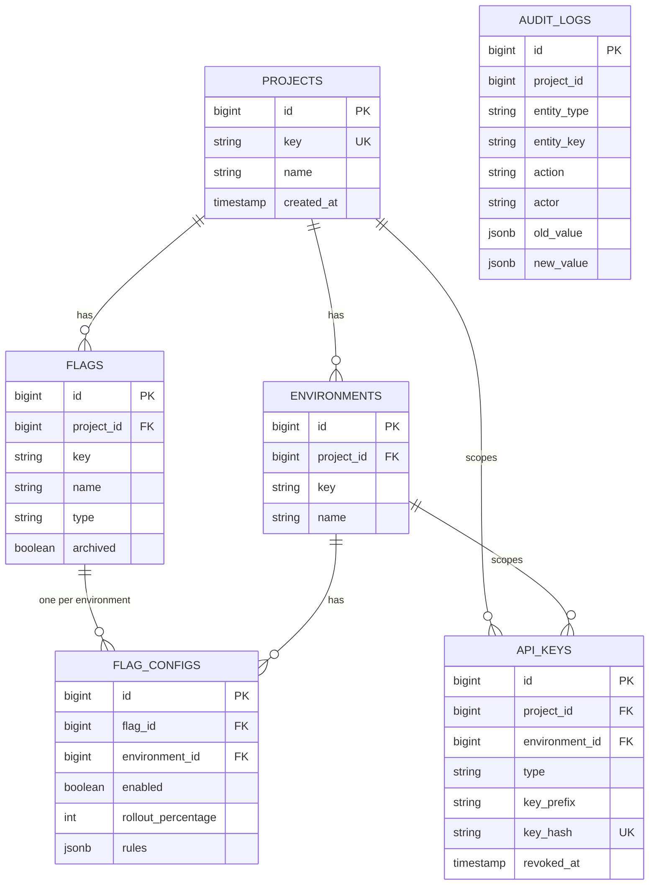
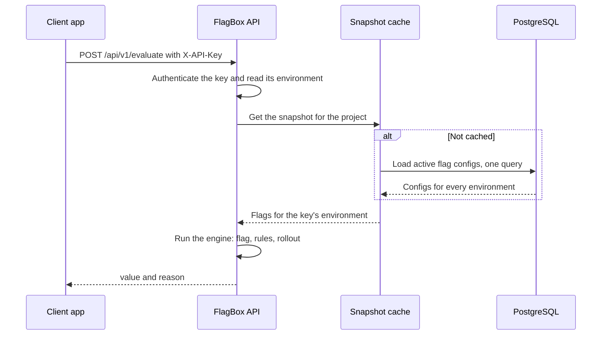

# Architecture

FlagBox is one Spring Boot application with one PostgreSQL database. It has no message broker and no extra services.
This page covers how it is organised, what the data looks like, how an evaluation runs, and the decisions behind the less obvious parts.

## Packages

The code is split by feature, not by layer. Each feature package holds its entities, repository, service and controller.

```
dev.a2zrr.flagbox
├── project/      projects: the top-level grouping
├── environment/  environments such as development and production
├── flag/         flags, per-environment configs, targeting rules
├── evaluation/   the evaluation engine (pure Java), the snapshot cache, the evaluation API
├── apikey/       API keys, authentication filter, access guard, rate limit, bootstrap key
├── audit/        audit log and the flag history endpoint
└── common/       errors and Problem Details, paging, security configuration
```

`evaluation` depends on `flag` for the rule types. `flag` does not depend on `evaluation`.
The engine itself (`EvaluationEngine`, `Rollout`, `Murmur3`) has no Spring or database imports, so it is tested on its own.

## Data model



Notes on the schema:

- Flag keys are unique per project. The same key can exist in two projects.
- `api_keys.project_id` and `environment_id` are both empty for a global admin key, and both set for every other key (migration V6).
- `api_keys` stores only the SHA-256 of a key. The raw key is never stored.
- `audit_logs` has no foreign keys, so history survives deletion of the thing it describes.
- Migrations are in `src/main/resources/db/migration`. Each change is a new file: V1 to V6 so far. Existing files are never edited.

## How an evaluation runs



The engine runs in this order, and the first step that decides wins:

1. Flag not found or archived: `null`, `FLAG_NOT_FOUND`.
2. Flag disabled: `false`, `FLAG_DISABLED`.
3. Rules in order. An off-list gives `false` (`USER_DENIED`), an on-list gives `true` (`USER_ALLOWED`), and an attribute rule gives its own value (`RULE_MATCH`).
4. Rollout: if the bucket is below the percentage, `true` (`ROLLOUT_IN`), otherwise `false` (`ROLLOUT_OUT`).

Rules are stored as JSON with a `type` discriminator, for example `{"type":"USER_LIST","userIds":["u1"],"value":true}`.
The `value` field is what the rule serves when it matches.

## Deterministic rollout

A user's bucket is `murmur3_32("flagKey:userId") mod 100`, using MurmurHash3 (x86, 32-bit, seed 0).

- **Stable.** The same user, flag and percentage always give the same bucket, on any machine. The hash is standard and documented, so clients can compute it too.
- **Monotonic.** Raising the percentage only adds buckets. Users inside 20% stay inside when it goes to 30%.
- **Independent per flag.** The flag key is part of the input, so one flag's rollout does not pick the same group as another flag's.

The tests check the hash against published vectors and against an independent implementation, and check the distribution over 10,000 users.

## Caching and invalidation

The evaluation path does not query the database once a project is warm.

- **What is cached.** For each project: every active flag in every environment, as plain definitions (`environmentId → flagKey → definition`). One query loads a whole project.
- **Where.** A Caffeine cache, at most 1,000 projects, with a 10-minute expiry as a safety net.
- **When it is evicted.** Every change that can change an answer evicts the project's entry: flag create, update, delete and archive, config updates, environment create and delete, and project delete.
- **After commit, not during the transaction.** Eviction is registered with the transaction and runs after commit. If it ran earlier, a read in between could load the old state and keep it in the cache.

The integration tests check this directly: a config change must show up in the next evaluation, and so must archiving, restoring and deleting a flag.

## Security model

- **Authentication.** Every request under `/api/v1` needs an `X-API-Key` header. Missing, malformed, unknown and revoked keys all return `401`, with the same message for unknown and revoked keys so attackers learn nothing.
- **Roles.** Evaluation accepts ADMIN and CLIENT keys. Everything else needs ADMIN, so a CLIENT key gets `403` on management endpoints.
- **Scope.** A key is either global (all projects, ADMIN only) or scoped to one environment. Each controller calls `AccessGuard`, which checks the project and environment in the path against the key.
- **Storage.** Keys are generated from 32 random bytes and stored as a SHA-256 hash. The raw key is returned once.
- **Bootstrap.** The first global admin key comes from `FLAGBOX_BOOTSTRAP_ADMIN_KEY` on first start. Later starts ignore the variable.
- **Errors.** Problem Details never include stack traces or internal messages. Unexpected errors return a reference ID that appears in the server log.
- **Container.** The image runs as a non-root user and contains no keys.

## Decisions made along the way

These are the choices that changed during the build. [DECISIONS.md](DECISIONS.md) has the short versions.

### The server does not serve a default value (V5)

The first design had a `defaultValue` on every config. We removed it. The server never invents a value: when a flag is missing, the calling application uses its own fallback. A second value per config only created confusion about which one applied. V5 drops the column. V2 was not edited.

### First match wins, and a rule serves its own value

Rules are checked in order, and the first match decides. An attribute rule serves its own `value`, so it can serve `false`. That matters for "block this country": a rule with `value: false`. Rule order is part of the contract, which is why an off-rule before an on-rule wins for a user in both lists. The tests cover both orders.

### Global keys and scoped keys (V6)

The bootstrap admin key must create projects, so it cannot belong to one project. V6 makes the scope columns nullable, with a check: a key is either global (no project, no environment, ADMIN only) or fully scoped. That keeps global keys explicit in the data, not a special case in the code.

### The last global admin key is protected by a lock

Revoking a global key is refused if it is the last active one. Checking "more than one active key" is not enough on its own: two requests could read the same count and both succeed. `revokeGlobalAdminKey` locks the active global keys (`SELECT … FOR UPDATE`) before it counts. `LastGlobalKeyConcurrencyIT` races two revocations of the last two keys, five times over, against the real database. Exactly one succeeds and the other gets `409`. Without the lock the test fails.

### The rate limit is per instance and in memory

Each key gets a Bucket4j token bucket, refilled greedily at the configured rate (default 100 per second). The buckets are held in memory, so the limit applies per running instance.

With several instances, a key would get the limit once per instance. Making it exact means a shared store: Redis with an atomic token-bucket script, or a database counter. Until then, put the limit in the load balancer, or accept an approximate limit. The clock is injectable, so the tests use a frozen one and do not depend on timing.

## Where to look

| Question | File |
|---|---|
| How is a decision made? | `evaluation/EvaluationEngine.java` |
| How is a rollout bucketed? | `evaluation/Rollout.java`, `evaluation/Murmur3.java` |
| What is cached, and when is it dropped? | `evaluation/FlagSnapshotCache.java` |
| Who may call what? | `common/config/SecurityConfig.java`, `apikey/AccessGuard.java` |
| How are errors shaped? | `common/error/ApiExceptionHandler.java` |
| How is the schema changed? | `src/main/resources/db/migration/` |
